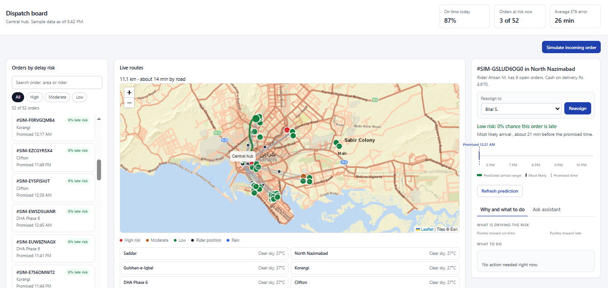
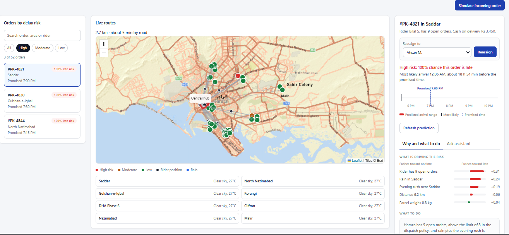
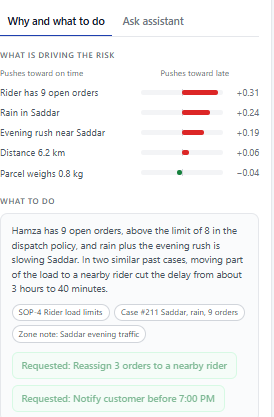
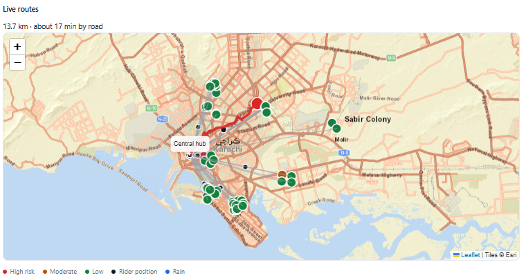
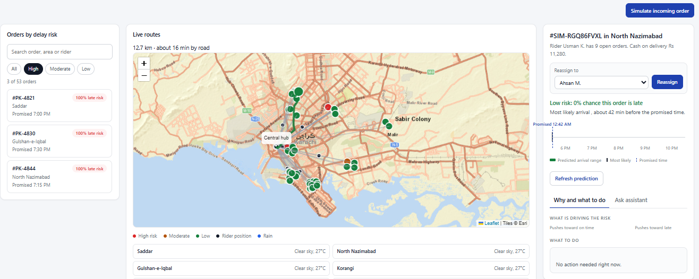
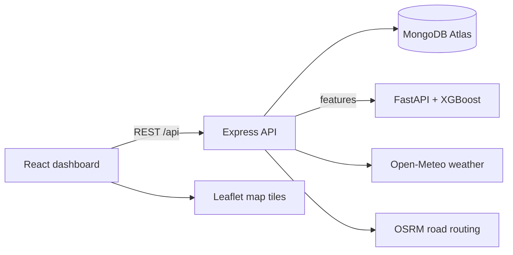

# Delivery ETA & Dispatch Dashboard

A full-stack dispatch dashboard that predicts late deliveries and estimated arrival time (ETA) for every active order, so dispatchers can act before the customer complains.



---

## The Problem

In most delivery companies, dispatchers only learn that an order is late after the customer complains. By then it is too late to change the route, reassign the rider, or warn the customer.

## The Solution

This project gives dispatchers early warning:

- An **XGBoost model** predicts the chance that each order will be late, along with its expected arrival time.
- The dashboard ranks orders by risk, so the riskiest ones appear first.
- Each order shows **why** it is risky (for example, rider overload or rain), with suggested actions.
- New orders are **assigned automatically** to the rider with the fewest active orders.
- The map shows **real road routes** and **live weather** for each area.



## Features

- **Live dashboard:** KPIs, risk-sorted order list, search and filters
- **Risk prediction:** late-delivery probability and ETA range from a FastAPI + XGBoost service
- **Explainability:** top risk drivers and suggested actions for each order
- **Auto rider assignment:** load-balanced assignment for incoming orders
- **Manual reassignment:** dispatcher can move an order to another rider
- **Order simulator:** generates realistic incoming orders for demos and testing
- **Order validation:** the API rejects invalid areas, distances, amounts and dates
- **Map:** Leaflet map with OpenStreetMap-based tiles, road routing via OSRM, and rain highlights
- **Weather:** per-area current weather from Open-Meteo (no API key required)
- **Assistant:** chat panel for questions about at-risk orders and overloaded riders







## Architecture



**Flow of a typical request:**

1. The dashboard loads all orders from `GET /api/dashboard/board`.
2. Selecting an order calls `GET /api/orders/:ref` and `GET /api/routes/:ref`.
3. **Refresh prediction** calls `POST /api/predictions/:ref`. The backend sends order features to the ML service, then saves the risk and ETA in MongoDB.
4. New orders go through validation, then rider assignment, then storage.

## Tech Stack

| Layer | Technology |
|---|---|
| Frontend | React, Vite, Leaflet (react-leaflet) |
| Backend | Node.js, Express, Mongoose |
| Database | MongoDB Atlas |
| ML service | Python, FastAPI, XGBoost, scikit-learn, pandas |
| External data | Open-Meteo (weather), OSRM (routing), OpenStreetMap-based tiles |

## Project Structure

```
delivery-eta-predictor/
├── backend/                 Express API and MongoDB models
│   └── src/
│       ├── config/          Areas, riders, hub settings, database connection
│       ├── models/          Order and DispatchSnapshot schemas
│       ├── routes/          API endpoints
│       ├── services/        Validation, rider assignment, ML client, weather, routing
│       ├── scripts/         Database seeding
│       └── server.js        Entry point
├── frontend/                React dashboard
│   └── src/
│       ├── components/      Order list, map, detail panel, chat, weather
│       ├── api.js           Backend calls
│       └── App.jsx          Main state and data flow
├── ml-service/              FastAPI prediction service
│   ├── app/main.py          /predict and /health endpoints
│   ├── train.py             Synthetic data generation and model training
│   └── models/              Trained model files (generated, not committed)
└── README.md
```

## Getting Started

### Prerequisites

- Node.js 18 or newer
- Python 3.11 or 3.12 (recommended)
- A MongoDB Atlas cluster (the free tier is enough)

### 1. Backend

```bash
cd backend
npm install
cp .env.example .env     # then set MONGO_URI to your Atlas connection string
npm run seed             # loads sample orders (development only)
npm run dev              # runs on http://localhost:5000
```

### 2. ML service

```bash
cd ml-service
python3 -m venv .venv
source .venv/bin/activate        # Windows: .venv\Scripts\activate
pip install -r requirements.txt
python train.py                  # trains and saves the models
uvicorn app.main:app --reload --port 8000
```

If you skip `train.py`, the service uses a simple fallback formula (`model_version` shows `heuristic-v0`).

### 3. Frontend

```bash
cd frontend
npm install
npm run dev                      # runs on http://localhost:5173
```

Open `http://localhost:5173` in your browser.

### Optional: MapTiler map style

To use MapTiler instead of the default Esri tiles, create `frontend/.env.local`:

```env
VITE_MAPTILER_KEY=your_key_here
```

Restart the frontend after adding it.

## Environment Variables

**`backend/.env`**

| Variable | Required | Description |
|---|---|---|
| `PORT` | No | Backend port (default `5000`) |
| `MONGO_URI` | Yes | MongoDB Atlas connection string |
| `ML_SERVICE_URL` | No | ML service URL (default `http://127.0.0.1:8000`) |
| `CLIENT_ORIGIN` | No | Frontend URL for CORS (default `http://localhost:5173`) |
| `WEATHER_PROVIDER` | No | `open-meteo` (default, no key) or `openweather` |
| `WEATHER_API_KEY` | Only for `openweather` | OpenWeatherMap API key |

Never commit `.env` files. They are listed in `.gitignore`.

## API Reference

| Method | Endpoint | Description |
|---|---|---|
| GET | `/api/health` | Server status |
| GET | `/api/dashboard/board` | Orders, KPIs, weather summary, hub |
| GET | `/api/orders/:ref` | Single order detail |
| POST | `/api/orders` | Create an order (external ingestion, auto rider assignment) |
| POST | `/api/orders/simulate` | Create a random incoming order (demo) |
| POST | `/api/orders/:ref/actions/:index` | Mark an action as requested |
| POST | `/api/orders/:ref/reassign` | Reassign an order to another rider |
| POST | `/api/predictions/:ref` | Run the ML model and save risk and ETA |
| POST | `/api/assistant/ask` | Ask the assistant a question |
| GET | `/api/weather` | Current weather per area |
| GET | `/api/routes/:ref` | Road route from the hub to an order |

Example:

```bash
curl -X POST http://localhost:5000/api/orders \
  -H "Content-Type: application/json" \
  -d '{"orderRef":"PK-5001","area":"Saddar","distanceKm":4.5,"amountPKR":2500,"paymentType":"COD","promisedAt":"2026-11-10T20:00:00+05:00"}'
```

## ML Model

- **Targets:** ETA in minutes (regression) and late-delivery probability (classification)
- **Features:** distance, weight, rider open orders, payment type, hour of day, day of week, minutes until the promised time
- **Algorithm:** XGBoost (`XGBRegressor` and `XGBClassifier`)
- **Results on the synthetic test set:** ETA MAE of about 9.4 minutes, delay ROC-AUC of about 0.985

> **Note:** The training data is synthetic. It is generated in `ml-service/train.py` using rules for distance, rush hour, rider load, area and rain. The metrics show that the pipeline works end to end, not how the model would perform on real delivery data. Retraining on real delivery records is the next step.

## Known Limitations

- Training data is synthetic. Real dispatch data is needed for production use.
- Rain affects the map display, but not the risk model yet.
- Road routing uses the public OSRM demo server, which has usage limits.
- The ETA bar uses a fixed time scale (5:30 PM to 10:30 PM), so orders outside that window appear off the bar.
- Authentication and user roles are not implemented.
- The assistant uses keyword matching. A RAG pipeline over SOPs and past cases is planned.

## Roadmap

- Add rain as a model feature and retrain
- Replace the keyword assistant with RAG over SOPs and past delay cases
- Train on real delivery data
- Add authentication and role-based access
- Deploy the frontend, backend and ML service

## Author

Laiba. Full-stack developer working on MERN and ML integration.
